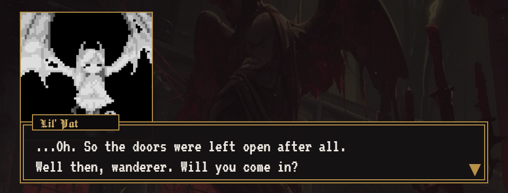
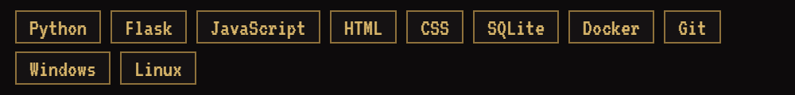

  

  

  
  &nbsp;&nbsp;
  

<h2 align="center" id="-about-me"></h2>

- I build an **MES for an SMT line**: component inventory, feeder setup, production output and traceability.
- Every day I work with **Korean SMT machines**: Hanwha Decan S1, S2 and L2.
- I write **Python**, build UIs in **JavaScript** and deploy with **Docker**.
- I like every board to have a history: from the reel to the serial number.
- Russian is my native language, English is my working one.

<h2 align="center"></h2>

  

<h2 align="center"></h2>

### MES · SMT line

Component inventory and traceability system for surface-mount assembly on Hanwha Decan lines.

**Features:** barcoded package inventory, BOMs and shortage calculation, feeder setup station with reel verification, production output with serial numbers, lot recall, full operation log.

<h2 align="center"></h2>

  
  
  

  

